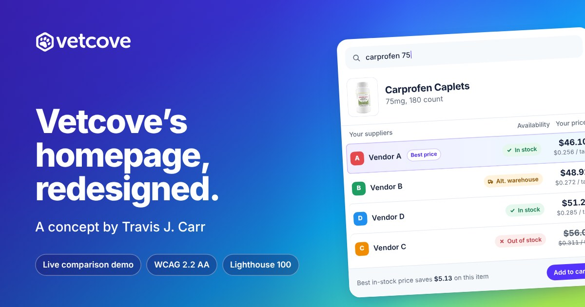

# Vetcove homepage — redesign concept

An unofficial redesign of the [shop.vetcove.com](https://shop.vetcove.com/) homepage by Travis J. Carr, made as part of a Product Engineer application. It keeps Vetcove's brand (logo, gradient, voice and content) and refines the typography, layout, interaction and accessibility.



> This is a concept, not a Vetcove page. It isn't affiliated with or endorsed by Vetcove, every link is disabled, and the page asks search engines not to index it.

## Highlights

- **A working product demo in the hero.** The static price card is now a live comparison: a search "types" each product, vendors re-rank by stock and price, rows animate to their new positions, and prices break down per tab, cap or mL. It pauses on hover, focus, when off-screen or in a background tab, and has its own pause button.
- **Same brand, more polish.** Vetcove's violet-to-cyan-to-lime gradient, angled section edges and logo carry through. Typography uses a proper scale, and the gradient is darkened under text so white copy stays readable.
- **Motion with restraint.** A short branded loader hands off to a single hero sequence; sections reveal as they scroll into view; buttons and links have considered hover states. Everything respects `prefers-reduced-motion`, and nothing is hidden if JavaScript doesn't run.

## Accessibility

Audited against **WCAG 2.2 AA** with axe-core, scripted keyboard passes, pixel-sampled contrast checks over gradients, 320px reflow, 200% zoom and text-spacing overrides.

- Two-tone focus ring that stays visible on white, gradient and dark backgrounds
- Skip link, landmarks and a logical heading outline
- `scroll-padding-top` so the sticky header never covers focused elements
- Mobile menu makes the rest of the page `inert`, moves focus in, and closes on <kbd>Esc</kbd>
- Status changes (cart, supplier connections) announced through a polite live region
- Visible labels match accessible names; stock states use icon + text, not color alone
- Autoplay has a pause control; decorative animations stop within five seconds
- Captioned video, loaded only on request

A manual screen reader pass (VoiceOver/NVDA) is still the final word.

## Performance

Lighthouse on the production build (local `vite preview`):

|         | Performance | Accessibility | LCP   | TBT   | CLS  |
| ------- | ----------- | ------------- | ----- | ----- | ---- |
| Mobile  | 100         | 100           | 1.3 s | 20 ms | 0    |
| Desktop | 100         | 100           | 0.3 s | 0 ms  | 0.01 |

How:

- **Self-hosted font.** One 20 KB variable woff2 (latin subset) covers every weight, preloaded.
- **Images.** The product sprite is a 13 KB WebP (from a 56 KB PNG), preloaded for the hero.
- **Critical CSS.** Above-the-fold CSS is inlined at build time ([Beasties](https://github.com/danielroe/beasties)) and the full stylesheet loads without blocking render. Rules for runtime animation states are kept inline so the page never flashes.
- **Video on demand.** Only a thumbnail ships; Vimeo's player loads when someone clicks play.
- **Small JS.** About 5 KB gzipped, no framework, all ES modules.

SEO scores low on purpose: the page is `noindex` and `robots.txt` disallows crawling, so a concept using Vetcove's brand never shows up in search.

## Getting started

Requires Node 20.19+ or 22.12+.

```bash
npm install
npm run dev       # local dev server
npm run build     # production build in dist/
npm run preview   # serve dist/
npm run format    # Prettier
```

### Deploying to GitHub Pages

A workflow in `.github/workflows/deploy.yml` builds and publishes the site on every push to `main`.

1. Push the repo to GitHub.
2. In the repo, go to **Settings → Pages** and set **Source** to **GitHub Actions**.
3. Push to `main` (or run the workflow from the **Actions** tab). The site appears at `https://<username>.github.io/<repo>/`.

On a `github.io/<repo>/` address, crawlers only read `robots.txt` at the domain root, so the page's `noindex` tag is what keeps it out of search.

The workflow fills in `SITE_URL` from the Pages address automatically. If you use a custom domain, set a repository variable named `SITE_URL` (**Settings → Secrets and variables → Actions → Variables**) to the full address, ending in `/`.

### Link previews

Social cards need absolute URLs. Set the page's final address when building:

```bash
SITE_URL=https://example.com/vetcove/ npm run build
```

or add `SITE_URL=...` to a `.env` file. Without it the build still works, but `og:url` is omitted and image paths stay relative. The build uses relative asset paths, so `dist/` can be uploaded to any sub-folder.

## Project structure

```
index.html                  Markup; tiny inline script sets animation state before first paint
vite.config.js              Relative base, SITE_URL replacement, font/image preloads
scripts/inline-critical.mjs Post-build: inline critical CSS, minify HTML
public/                     Favicon, touch icon, share image, robots.txt
src/
  assets/                   Self-hosted font, product sprite
  scss/
    abstracts/              Tokens, mq() and hover() mixins
    base/                   Fonts, element defaults, focus ring, reduced motion
    components/             Buttons, links, comparison card, video, loader, toast
    layout/                 Header, mobile menu, footer
    sections/               One partial per page section
    utilities/_animations   Entrance animation system
    main.scss               Imports, in cascade order
  js/
    main.js                 Entry point; initializes modules in order
    lib/                    Environment flags, helpers, live-region announcements
    compare/                Comparison demo and its sample data
    reveal/                 Scroll reveals, word-split headings, count-up
    *.js                    Loader, header, mobile menu, vendors, video, FAQ, buttons, links
```

### Conventions

- **Mobile-first.** Base styles target small screens; larger layouts are added with `@include mq(sm|md|lg|xl)` (min-width only). Hover effects live behind `@include hover` so taps don't leave sticky states.
- **Progressive enhancement.** CSS only hides content for animation under `html.anim`, which the inline script adds when motion is allowed.
- **No dependencies at runtime.** Vite and Sass for the build only.

## Credits

Vetcove's name, logo, product photos, testimonials and copy belong to Vetcove Inc. and are used here only to illustrate the concept. Partner logos belong to the AVMA, AAEP and Feline VMA. Figtree is by Erik Kennedy, licensed under the SIL Open Font License; Vetcove's own typeface, Sofia Pro, is listed first in the font stack for anyone who has it installed.
